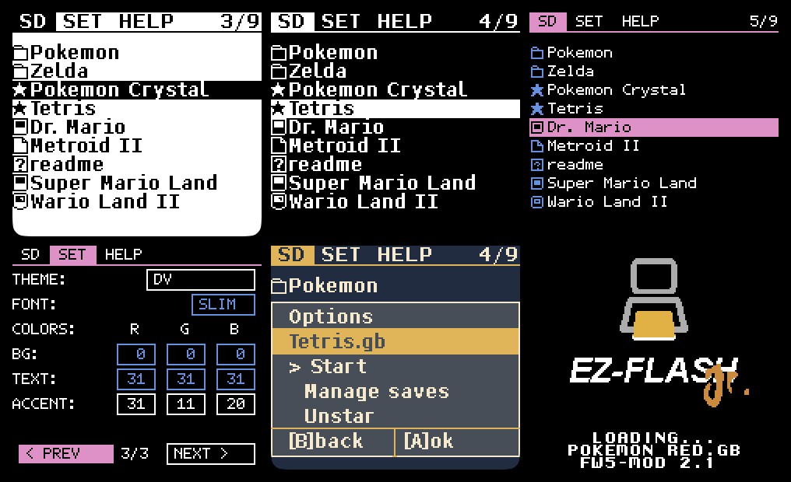

# EZ Flash Jr from source

The EZ Flash Jr is a Game Boy / Game Boy Color flash cartridge. EZ Flash
published no source for it, unlike its GBA sibling the
[EZ Flash Omega](https://github.com/ezflash-team/omega-de-kernel): the menu
(the "kernel"), the bootloader and the FPGA design ship only as binaries.

This repository rebuilds all of it from source. The Game Boy programs
compile to the stock bytes, and the FPGA design is readable Verilog proven
equivalent to the stock bitstream. No file of EZ Flash's is in the
repository, and none is needed to build.

| Piece | What it is | Source | Result |
|---|---|---|---|
| Kernel 1.04e, 1.05e-0731, 1.05e-0918 | the menu, loaded from the SD card as `ezgb.dat` | [kernel/stock](kernel/stock/README.md): C, GBDK, FatFs | identical to stock |
| Stage1, FW4 and FW5-0918 | the bootloader, stored in the FPGA's block RAM | [stage1/decomp](stage1/decomp/README.md): C, GBDK | identical to stock |
| The updater's program, FW4 and FW5-0918 | the first 32 KB of an updater, the Game Boy program that writes the flash | [stage0/updater](stage0/updater/README.md): C | identical to stock |
| Slot B, FW4 and FW5-0918 | the rest of an updater, the FPGA configuration it writes | [stage0](stage0/README.md): Verilog, the PicoBlaze's two programs, stage1 | proven equivalent to the stock netlist |

The first three come out as the same bytes EZ Flash shipped, checked by
hash. Slot B does not: ISE places and routes the logic its own way, so the
bitstream built here has different bits from the stock one and is proven to
be the same circuit instead. An updater is its program followed
by slot B, so an updater built entirely from source does not have the
official file's hash. Its program does, and with the stock bitstream after
it the whole file does.

Both from-source firmwares have been flashed to carts with the updater
built from source, and run the kernels built from source.

FW4 and FW5 are the two firmware generations; a cart runs one or the other
([which is which](docs/kernel-versions.md)). 1.04e is the kernel for FW4,
and both 1.05e builds are for FW5.

## Building

```sh
stage1/decomp/tools/build-sdcc29.sh    # once: SDCC 2.9.0 into tools/sdcc-2.9.0
make                                   # three kernels, two stage1s, two updater programs
make compare                           # that, then every result against stock.sha1
```

[stock.sha1](stock.sha1) lists the hash of each stock binary, and a build
fails if its result is not the one listed. This needs SDCC 2.9.0 (the
compiler EZ Flash used), a current SDCC, RGBDS, GNU make and Python 3.

The FPGA side needs Xilinx ISE 14.7 on a Linux machine and, for the proof,
yosys and the official updater to prove against:

```sh
make stage0-stock BUILD_HOST=<build host>            # both firmwares, proven
PROVE=0 make stage0-stock BUILD_HOST=<build host>    # built, not proven
```

[INSTALL.md](INSTALL.md) has the tools, the versions checked and the build
host setup.

## How it is put together

- **Kernel:** C compiled with SDCC 2.9.0 against GBDK 2.96a and FatFs
  R0.11a, with the edits EZ Flash made to both marked. One tree builds all
  three kernels; 1.05e-0731 is the reference the other two are written
  against ([kernel/stock](kernel/stock/README.md)). Each build also has an
  annotated disassembly that assembles to the stock kernel
  ([kernel/stock/disassembly](kernel/stock/disassembly/),
  [differences between the builds](docs/kernel-diffs.md)).
- **Stage1:** the bootloader that finds `ezgb.dat` on the card and starts
  it, in C for both firmwares ([stage1/decomp](stage1/decomp/README.md)),
  with a disassembly of each ([stage1/stock.md](stage1/stock.md)).
- **FPGA:** the bitstream is decoded to a netlist
  ([index](docs/fpga.md),
  [floorplan viewer](https://lukesau.github.io/ezgb/floorplan/)) and
  rewritten as readable Verilog, proven equivalent block by block and then
  as a whole ([stage0](stage0/README.md),
  [design](stage0/docs/design.md), [blocks](stage0/docs/blocks.md)). ISE
  builds a slot B image from that Verilog, which is proven against stock
  again ([stage0/ise](stage0/ise/README.md)).
- **PicoBlaze:** the soft CPU inside the FPGA that runs the SD card, the
  loader, the clock and the flash. Its two programs are annotated listings
  that assemble to the stock words
  ([picoblaze.md](stage0/docs/picoblaze.md)).
- **Updater:** a cut-down kernel that writes slot B to the configuration
  flash ([updater.md](stage0/docs/updater.md),
  [flash map](stage0/docs/flash-map.md)).
- **Hardware:** the [board](docs/hardware-board.md), the
  [registers](stage0/docs/design.md#registers-written-by-the-game-boy), the
  [boot and launch paths](docs/boot-and-launch.md), the
  [FW4 to FW5 changes](stage0/docs/firmware-diff.md) and
  [why the coin cell dies in a month](docs/battery-sram-swap.md).

Three pieces have no published source to match and are rebuilt from the
stock bytes: a few library routines in assembly, the Verilog, and the
PicoBlaze's programs ([INSTALL.md](INSTALL.md#what-is-not-from-found-source)).
Code that is other people's keeps its license
([THIRD-PARTY.md](THIRD-PARTY.md)).

## The mod



Built on the same work: a nicer menu with themes, fonts, save management
and fast launch, plus an optional replacement bootloader. It predates the
source build and is a set of patches on the stock 1.05e-0731 kernel, ported
to the other two. To build it, add a feature or rebuild a disassembly,
start with [docs/DEVELOPMENT.md](docs/DEVELOPMENT.md).

### Getting it

Use the [patcher page](https://lukesau.github.io/ezgb/patcher/). It checks
your `ezgb.dat` and applies the right patch in the browser. Copy the result
to the card root as `ezgb.dat` and keep the stock file to go back. The HELP
tab shows `MOD N.M` when it's running.

Nothing is flashed: the Jr loads `ezgb.dat` from the microSD card at every
power-on, so swapping kernels is swapping a file.

To patch by hand, take the IPS for your kernel from the
[latest release](https://github.com/lukesau/ezgb/releases/latest) and apply
it to the stock `ezgb.dat` from EZ Flash's
[firmware package](https://www.ezflash.cn/download/):

| Kernel | Stock `ezgb.dat` md5 |
|---|---|
| 1.04e (FW4) | `b8c29fa5a94c37200434e4c72f0cdfea` |
| 1.05e-0731 (FW5) | `91eb7fc67332ef20b5691029181ff748` |
| 1.05e-0918 (FW5) | `5238ac5987d23b68a19d40e43af8c786` |

Not sure which one? See
[which kernel should I choose](docs/kernel-versions.md). This repo never
redistributes EZ Flash's binaries, so there is no ready-made `ezgb.dat` to
download ([why, and the other ways to build one](docs/distribution.md)).

#### The firmware mod

Optional and experimental: a new bootloader with a themed splash, fast
launch, a kernel picker and, on FW5-0918, SD error recovery. Unlike the
kernel it is flashed, like an official firmware update. An interrupted write
nearly always falls back to the cart's factory firmware, but in rare cases
needs hardware tools to repair. The patcher page explains the risk and
refuses anything but the exact stock updater.

### Features

Each links to a doc with the details.

**Look**

- [12px font](docs/font12.md): a proportional font with kerning, 10 rows a
  page, on every screen. `FONT:` on the SET tab.
- [Themes](docs/themes.md): light, dark, DV, four colors, or your own
  background, text and accent from a picker on the SET tab.
- [File icons and a readable highlight](docs/browser.md#icons-and-the-selection-bar): white on
  black instead of black on dark gray, which an original Game Boy can't show.
- [Clean ROM names](docs/browser.md#clean-names): `Tetris (World) (Rev 1).gb`
  shows as `Tetris`.
- [Closed boxes](docs/prompts.md) for the prompts and the START
  overlay, and [no streaks](docs/drawing-timing.md) in the text.

**Browser**

- [Sorted](docs/browser.md#sorting), folders first, with
  [clutter hidden](docs/browser.md#what-is-hidden): macOS junk, `.gba` and `.nds` files,
  saves, kernels, the settings file, names starting with `_`, and whatever
  the card's `.ezgbhide` lists.
- [Fast navigation](docs/browser.md#moving-around): the list wraps, shows `n/total`,
  and speeds up when UP or DOWN is held.
- [No lost button presses](docs/input.md): the pad is read every
  frame.
- [Hold A for options](docs/rom-menu.md): start, manage saves, star.
- [Text viewer](docs/text-viewer.md): A on a `.txt`, `.ini` or `.md` file
  opens it to read.
- [Stars and play counts](docs/stars.md): starred ROMs stay on top, and the
  list can sort by most played.

**Saves and clock**

- [Manage saves](docs/save-manager.md): back up, restore and delete a ROM's
  saves on the cart, with an optional
  [daily backup](docs/save-manager.md#daily-backup).
- [Safe with a dead battery](docs/prompts.md): records that faded in
  cart RAM are checked before use, so no garbage gets written to the card.
- [RTC backup](docs/ezgb-cfg.md): the clock is copied to the card and
  offered back when the coin cell lets it reset.

**Launching**

- [Fast launch](docs/fast-launch.md): boot straight into a ROM,
  [set up on the cart](docs/set-tab.md). Hold START at power-on
  for the browser.
- [Skip the boot ROM](docs/skip-boot-rom.md): a game starts without the
  console's boot animation playing a second time.
- [Faster loading on FW5](stage0/docs/firmware-diff.md) on every console,
  not just a GBC.
- [Super Game Boy support](docs/sgb-boot.md), after nitro2k01's SGB Enabler.
- [Last ROM](docs/last-rom.md): START relaunches the last game, even after
  the battery dies.

## Repo layout

```
kernel/     The menu program
              stock/                           all three kernels from source, and their
                                               annotated disassembly
              1.04e/ 1.05e-0731/ 1.05e-0918/   disassembly, symbols and notes per build
              mod/                             the mod: C and asm sources, inject tooling
              stock-1.06/ mod-1.06/            EZ Flash's 1.06 source as received, and
                                               with the FW6 clock load
              tools/                           build, port, inject and release scripts
stage1/     The bootloader
              decomp/                          EZ Flash's stage1 from source
              fw4/ fw5-0918/                   EZ Flash's stage1, disassembled
              src/ art/ font/ tools/           the mod's replacement
stage0/     The FPGA design
              fw4/ fw5-0918/                   per firmware: Verilog and block files, PicoBlaze
                                               listings, bitstream decode, pin and register maps
              ise/                             building slot B with ISE, and its proof
              updater/                         the updater from source
              sim/ netlist/ lib/ tools/ docs/  shared: simulation, analysis, tools, write-ups
docs/       Hardware notes, findings, the mod's feature write-ups
patches/    IPS patches for the kernel and the firmware updaters, SameBoy stub
scripts/    Emulator, SD image, patcher page and banner helpers
stock.sha1  The hash of every stock binary the build is checked against
```

EZ Flash's binaries (kernels, bitstreams, updaters) and third-party tools
are not tracked. The source build needs none of them; the mod and the
proofs read a dump the checkout supplies
([docs/DEVELOPMENT.md](docs/DEVELOPMENT.md#setting-up-a-checkout)).

## Credits

- **[daid/ezflashjr](https://github.com/daid/ezflashjr)** by Daid, with
  contributions from nitro2k01: the cart's register protocol
  (`doc/Protocol.md`), stage1 dumps, board survey, and archived official
  firmware. The SameBoy EZ Jr stub's game-launch path is built on its protocol
  doc, and several hardware docs here start from its findings.
- **[fishcu](https://github.com/fishcu)**: shared their own EZ-Flash Junior
  research notes, which caught stock FW5 stage1's `$7FD3` write (the reason
  the fast-load key works on CGB with stock firmware, and that mod 5.5 had
  turned it off), the updater's `$7FC0` writes and stage1's cart type.
- **[davidesqalv](https://github.com/davidesqalv)**: his fork,
  [ezgb-dv](https://github.com/davidesqalv/ezgb-dv), had starred games, play
  count sorting, file names without extensions and a smaller status box
  first. Mod 7.1 brings those over, and its DV theme is an homage to his
  look: his icons and 12px font choice (Tamzen 6x12), black with lime and
  blue. The list navigation and the daily save backup are his code.
- **[prjcombine](https://codeberg.org/prjunnamed/prjcombine)**: coolest
  project ever. I thought reverse engineering the FPGA bitstream would be a
  research project of its own, but they already did that research.
- **[omega-de-kernel](https://github.com/ezflash-team/omega-de-kernel)**: EZ
  Flash's published GBA kernel source, used to interpret the Jr's register
  design.
- **[SameBoy](https://github.com/LIJI32/SameBoy)**,
  **[mgbdis](https://github.com/mattcurrie/mgbdis)**,
  **[rgbds](https://github.com/gbdev/rgbds)** and pret's
  **[gb-asm-tools](https://github.com/pret/gb-asm-tools)**: emulation,
  disassembly, and assembly.

## License

AGPLv3, see [LICENSE](LICENSE). It covers this project's work: the notes,
the tooling, the mod, the readable Verilog. It does not relicense EZ
Flash's code, which is here as source written from their binaries, and
their binaries are not in the repository. Other people's code keeps its
license; [THIRD-PARTY.md](THIRD-PARTY.md) lists it.
