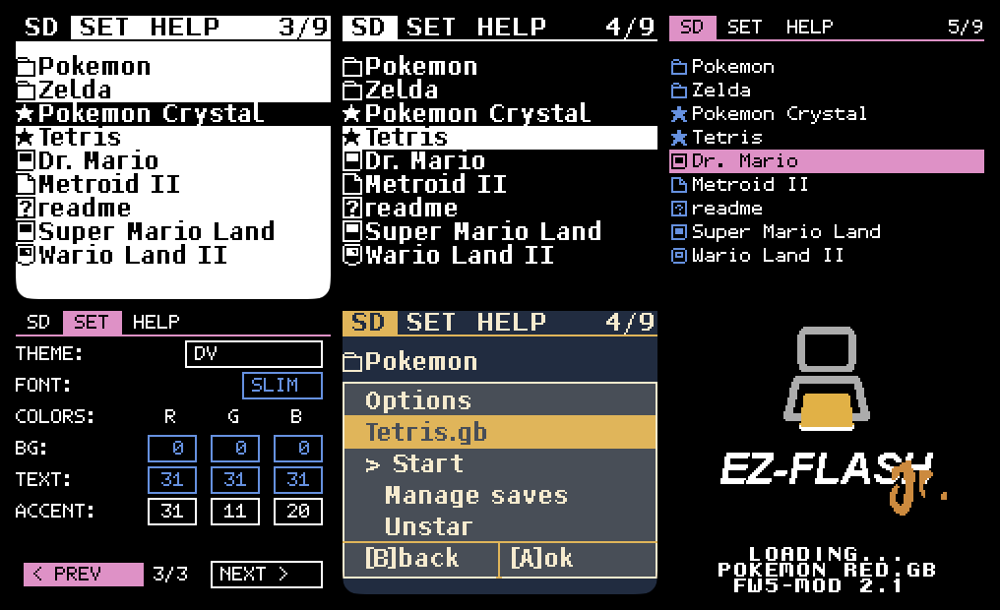

# EZ Flash Jr kernel: reverse engineering & mods



The EZ Flash Jr is a Game Boy / Game Boy Color flash cartridge. Its menu
(the "kernel") ships only as a compiled binary with no published source,
unlike its GBA sibling the
[EZ Flash Omega](https://github.com/ezflash-team/omega-de-kernel).

This repo reverse-engineers the kernel and the cart's FPGA firmware, and
builds a mod on top: a nicer menu with themes, fonts, save management and
fast launch, plus an optional replacement bootloader.

## Getting the mod

Use the [patcher page](https://lukesau.github.io/ezgb/patcher/). It checks
your `ezgb.dat` and applies the right patch in the browser. Copy the result
to the card root as `ezgb.dat` and keep the stock file to go back. The HELP
tab shows `MOD N.M` when it's running.

Nothing is flashed: the Jr loads `ezgb.dat` from the microSD card at every
power-on, so swapping kernels is swapping a file.

To patch by hand, take the IPS for your kernel from the
[latest release](https://github.com/lukesau/ezgb/releases/latest) and apply
it to the stock `ezgb.dat` from EZ Flash's
[firmware package](https://www.ezflash.cn/download/):

| Kernel | Stock `ezgb.dat` md5 |
|---|---|
| 1.04e (FW4) | `b8c29fa5a94c37200434e4c72f0cdfea` |
| 1.05e-0731 (FW5) | `91eb7fc67332ef20b5691029181ff748` |
| 1.05e-0918 (FW5) | `5238ac5987d23b68a19d40e43af8c786` |

Not sure which one? See
[which kernel should I choose](docs/kernel-versions.md). This repo never
redistributes EZ Flash's binaries, so there is no ready-made `ezgb.dat` to
download ([why, and the other ways to build one](docs/distribution.md)).

### The firmware mod

Optional and experimental: a new bootloader with a themed splash, fast
launch, a kernel picker and, on FW5-0918, SD error recovery. Unlike the
kernel it is flashed, like an official firmware update. An interrupted write
nearly always falls back to the cart's factory firmware, but in rare cases
needs hardware tools to repair. The patcher page explains the risk and
refuses anything but the exact stock updater.

## Features

Each links to a doc with the details.

**Look**

- [12px font](docs/font12.md): a proportional font with kerning, 10 rows a
  page, on every screen. `FONT:` on the SET tab.
- [Themes](docs/dark-mode.md): light, dark, DV, four colors, or your own
  background, text and accent from a picker on the SET tab.
- [File icons and a readable highlight](docs/dmg-ui-visibility.md): white on
  black instead of black on dark gray, which an original Game Boy can't show.
- [Clean ROM names](docs/browser-tags.md): `Tetris (World) (Rev 1).gb`
  shows as `Tetris`.
- [Closed boxes](docs/modal-prompts.md) for the prompts and the START
  overlay, and [no streaks](docs/vram-write-race.md) in the text.

**Browser**

- [Sorted](docs/browser-sort.md), folders first, with
  [clutter hidden](docs/browser-hide-filter.md): macOS junk, `.gba` and `.nds` files,
  saves, kernels, the settings file, names starting with `_`.
- [Fast navigation](docs/browser-nav.md): the list wraps, shows `n/total`,
  and speeds up when UP or DOWN is held.
- [No lost button presses](docs/joypad-latch.md): the pad is read every
  frame.
- [Hold A for options](docs/rom-menu.md): start, manage saves, star.
- [Stars and play counts](docs/stars.md): starred ROMs stay on top, and the
  list can sort by most played.

**Saves and clock**

- [Manage saves](docs/save-manager.md): back up, restore and delete a ROM's
  saves on the cart, with an optional
  [daily backup](docs/save-manager.md#daily-backup).
- [Safe with a dead battery](docs/modal-prompts.md): records that faded in
  cart RAM are checked before use, so no garbage gets written to the card.
- [RTC backup](docs/ezgb-cfg.md): the clock is copied to the card and
  offered back when the coin cell lets it reset.

**Launching**

- [Fast launch](docs/fast-launch-notes.md): boot straight into a ROM,
  [set up on the cart](docs/fastlaunch-set-tab.md). Hold START at power-on
  for the browser.
- [Skip the boot ROM](docs/skip-boot-rom.md): a game starts without the
  console's boot animation playing a second time.
- [Faster loading on FW5](re/stage0/docs/firmware-diff.md) on every console,
  not just a GBC.
- [Super Game Boy support](docs/sgb-boot.md), after nitro2k01's SGB Enabler.
- [Last ROM](docs/last-rom.md): START relaunches the last game, even after
  the battery dies.

## The reverse engineering

- **Kernel:** every bank is disassembled and labeled, and reassembles to the
  original for all three builds. [decomp/](decomp/README.md) is turning it
  into C.
- **Hardware:** the [board](docs/hardware-board.md), the
  [registers](docs/REGISTERS.md), the [boot](docs/boot-map.md) and
  [launch](docs/launch-trace.md) paths, and
  [why the coin cell dies in a month](docs/battery-sram-swap.md).
- **FPGA:** the bitstream is decoded ([index](docs/fpga.md),
  [floorplan viewer](https://lukesau.github.io/ezgb/floorplan/)) and
  [stage0/](stage0/README.md) rewrites it as readable Verilog, proven
  equivalent block by block.
- **Bootloader:** [stage1/](stage1/README.md) is a from-source replacement,
  the firmware mod above.

To build the mod yourself, add a feature or rebuild a disassembly, start
with [docs/DEVELOPMENT.md](docs/DEVELOPMENT.md).

## Repo layout

```
kernel/     The mod: feature sources (C and asm) and the inject tooling
patches/    IPS patches for the kernel and the firmware updaters, SameBoy stub
stage1/     The bootloader, from source
stage0/     The FPGA design as Verilog, and the PicoBlaze patches
re/         Disassemblies and notes: kernel/ (three builds), stage0/, stage1/, updater/
decomp/     The stock kernel rebuilt from source, checked byte for byte
docs/       Feature write-ups, hardware notes, findings
scripts/    Build, port, release and emulator helpers
```

EZ Flash's binaries (kernels, bitstreams, updaters) and third-party tools
are not tracked. A checkout supplies its own dump; see
[docs/DEVELOPMENT.md](docs/DEVELOPMENT.md#tools).

## Credits

- **[daid/ezflashjr](https://github.com/daid/ezflashjr)** by Daid, with
  contributions from nitro2k01: the cart's register protocol
  (`doc/Protocol.md`), stage1 dumps, board survey, and archived official
  firmware. The SameBoy EZ Jr stub's game-launch path is built on its protocol
  doc, and several hardware docs here start from its findings.
- **[fishcu](https://github.com/fishcu)**: shared their own EZ-Flash Junior
  research notes, which caught stock FW5 stage1's `$7FD3` write (the reason
  the fast-load key works on CGB with stock firmware, and that mod 5.5 had
  turned it off), the updater's `$7FC0` writes and stage1's cart type.
- **[davidesqalv](https://github.com/davidesqalv)**: his fork,
  [ezgb-dv](https://github.com/davidesqalv/ezgb-dv), had starred games, play
  count sorting, file names without extensions and a smaller status box
  first. Mod 7.1 brings those over, and its DV theme is an homage to his
  look: his icons and 12px font choice (Tamzen 6x12), black with lime and
  blue. The list navigation and the daily save backup are his code.
- **[prjcombine](https://codeberg.org/prjunnamed/prjcombine)**: coolest
  project ever. I thought reverse engineering the FPGA bitstream would be a
  research project of its own, but they already did that research.
- **[omega-de-kernel](https://github.com/ezflash-team/omega-de-kernel)**: EZ
  Flash's published GBA kernel source, used to interpret the Jr's register
  design.
- **[SameBoy](https://github.com/LIJI32/SameBoy)**,
  **[mgbdis](https://github.com/mattcurrie/mgbdis)**,
  **[rgbds](https://github.com/gbdev/rgbds)** and pret's
  **[gb-asm-tools](https://github.com/pret/gb-asm-tools)**: emulation,
  disassembly, and assembly.

## License

AGPLv3, see [LICENSE](LICENSE). Covers this project's work (disassembly,
notes, tooling, feature code). It does not relicense EZ Flash's original
firmware, which is not redistributed here.
